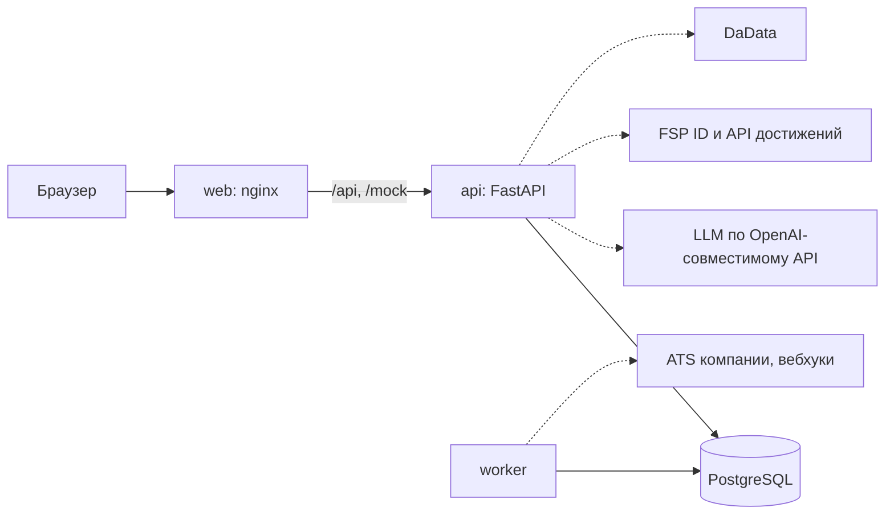
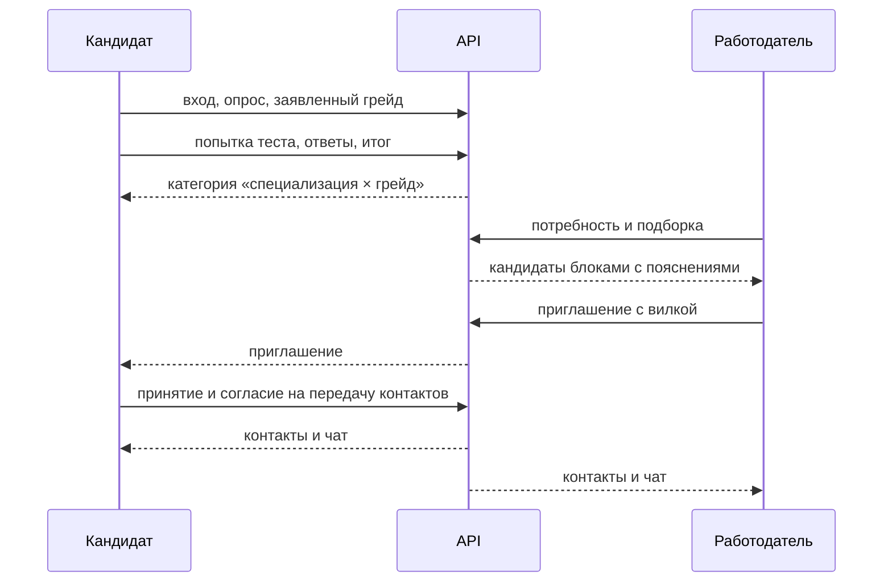

# Архитектура

## Стек

| Слой | Выбор |
|---|---|
| Бэкенд | Python 3.12, FastAPI, синхронный SQLAlchemy 2, Pydantic v2, uvicorn с 2–4 воркерами, пул соединений 10 |
| Миграции | Alembic: базовая ревизия, дальше ревизия на каждое изменение моделей (`make migration`). Контейнер `api` при старте выполняет `upgrade head`. В тестах `create_all` ради скорости; `tests/test_migrations.py` сверяет миграции с моделями |
| БД | PostgreSQL 16 |
| Фронтенд | React 18, Vite, TypeScript, TanStack Query, React Router, Tailwind, shadcn/ui, Recharts. Типы API генерирует `openapi-typescript` по команде `make types`, поверх — тонкая обёртка над fetch |
| Стиль | Палитра ФСП (#FF0053, #FC3777, #310F53, #520978, #8A83D1, #FFD6E4, #1C1D22), шрифт Montserrat, адаптивная вёрстка |
| LLM | OpenAI SDK, провайдер — Polza.ai (российский агрегатор с OpenAI-совместимым API; `LLM_BASE_URL` / `LLM_API_KEY`, также читаются `OPENROUTER_*` из `.env`). Модель выбирается отдельно под задачу. Данные кандидата идут только в `sber/gigachat-2-pro`, запасной вариант — `yandex/yandexgpt-5.1-pro`. GigaChat через агрегатор поддерживает только `json_object`; обе модели оборачивают JSON в markdown-блок. Поэтому в режиме `json_object` модель получает образец объекта, а единственная обёртка разворачивается. Модуль `llm` извлекает первый JSON-объект, валидирует его через Pydantic, делает один повтор, дальше включает фолбэк. Qwen, gpt-oss, DeepSeek и Gemma помечены в агрегаторе флагом «данные в РФ», но по умолчанию уходят к зарубежному провайдеру; для ПДн они не используются |
| Безопасность | argon2-cffi; session-cookie (непрозрачный токен в httpOnly-cookie, в БД хранится хэш); PyJWT + httpx (OIDC-клиент FSP ID: discovery, PKCE S256, проверка ID token по JWKS) |
| Данные и ML | numpy, pdfplumber / pypdfium2, natasha (импортируется лениво, фолбэк на регулярки), reportlab для PDF-профиля |
| Тесты | pytest, httpx, hypothesis; e2e-гид на уровне API; Playwright — один smoke-тест в конце |
| Качество | ruff, CI в GitHub Actions (lint + unit + API), нагрузочный скрипт k6 |

## Компоненты

Стек собран из контейнеров. Наружу смотрит только веб-сервер, остальное живёт во внутренней сети.

| Сервис | Роль | Лимит памяти |
|---|---|---|
| `web` | nginx: собранный фронтенд и прокси `/api` и `/mock` на API | 64 МБ |
| `api` | FastAPI: бизнес-логика, два воркера uvicorn | 512 МБ |
| `worker` | тот же образ: письма, дайджесты, напоминания, вебхуки, фоновые прогоны лаборатории | 384 МБ |
| `db` | PostgreSQL 16, healthcheck | 256 МБ |
| `mailpit` | почта для демо | 64 МБ |
| `mocks` | встроенные моки внешних систем (FSP ID, API достижений, DaData, ATS), это роуты процесса `api`; включаются при `MOCKS_ENABLED` (по умолчанию как `DEMO_MODE`). Отдельный контейнер не помещается в 1,5 ГБ стенда | — |

Все сервисы стартуют с `depends_on: condition: service_healthy`. При первом старте автоматически выполняется `seed`. Команды: `make up`, `seed`, `validate`, `test`, `types`, `openapi`.



Внешние системы на схеме пунктиром: без ключа LLM и с включёнными моками продукт работает целиком.

## Модульный монолит

Один бэкенд, разделённый по модулям. Модули общаются через сервисный слой и не читают таблицы друг друга.

| Модуль | Зона ответственности |
|---|---|
| `auth` | пользователи, роли, сессии, токены подтверждения и сброса, согласия, привязка FSP ID, демо-персоны |
| `candidates` | профиль, стек, резюме и PDF, условия, приватность, блокировки компаний |
| `assessment` | банк заданий, генераторы, движок теста, попытки, навыки, «Работа с ИИ», кулдауны |
| `fsp` | достижения ФСП, расчёт коэффициента, команды |
| `employers` | компании, потребности, разбор текста вакансии |
| `trust` | уровни доверия, проверка юрлица через DaData |
| `matching` | карта, ранжирование, объяснения (кэш), шортлист |
| `contacts` | приглашения, квоты, чат, сигналы, задачи, вакансии |
| `hiring` | этапы найма, голоса с собеседований и множитель `m`, бейдж, калибровка, споры об оценках |
| `initiative` | «Хочу к вам» и спрос по категории |
| `groups` | командный найм: группы и командные приглашения |
| `junior` | юниорский трек 14–17 лет |
| `employer_tasks` | задачи компаний и их модерация |
| `vacancies` | вакансии и отклики |
| `moderation` | очередь обращений |
| `integrations` | outbox, вебхуки, почта, ATS |
| `notifications` | уведомления |
| `llm` | провайдер, маскирование, валидация ответов, проверка фактов, circuit breaker |
| `lab` | симуляции и отчёты |
| `audit` | журнал действий, включая просмотр контактов |
| `demo` | засев данных, сбросы, режим демо |

Инфраструктурные пакеты: `common` (часы, csrf, безопасность, подпроцессы), `config` (параметры и настройки), `db` (сессии и модели), `mocks` (встроенные внешние системы), `assets` (шрифты).

Почему монолит: один разработчик и ИИ-агент, слабый сервер и жёсткий срок. Модули с явной границей дают ту же читаемость, что микросервисы, без сети между ними.

## Сквозной сценарий

Шесть шагов гида на уровне запросов.



## Ленивые статусы и worker

Всё, что зависит от времени, считается при чтении: истечение приглашения или встречного предложения, вступление оценки в силу, автозакрытие попытки. Worker только ускоряет: истечение и напоминания, письма, вебхуки и фоновые прогоны лаборатории. Если worker остановится, продукт продолжит работать. Повторы идемпотентны: уведомления по ключу, доставка вебхуков по паре «эндпоинт и событие». Worker — APScheduler, один экземпляр, интервал 1 минута; задачи идемпотентны через `notifications.dedupe_key` и `outbox`.

## Модель данных

Схема описана моделями SQLAlchemy. Диаграмма связей выгружается скриптом:

```bash
cd backend && uv run python -m tools.er_diagram > ../docs/er.mmd
```

Готовые диаграммы — в `docs/er.mmd`. Инварианты держатся частичными уникальными индексами: одно активное приглашение на пару «потребность и кандидат», одна активная попытка, один активный прогон лаборатории.

### Пользователи, сессии, согласия

- `users`: id, email, role, password_hash, **birth_year**, **birth_date**, email_verified_at, created_at.
  - `birth_date` — точный возраст для юниорского трека; без неё возраст считается по `birth_year` консервативно (младший из возможных).
- `sessions`: id, user_id, token_hash, created_at, expires_at, revoked_at, impersonated_by.
- `email_tokens`: id, user_id, purpose ∈ {verify, reset, guardian}, token_hash, expires_at, used_at.
- `external_identities`: user_id, provider, issuer, subject, linked_at, last_sync_at.
  - Ограничения UNIQUE(issuer, subject) и UNIQUE(user_id, provider).
  - Один FSP ID нельзя привязать к двум аккаунтам — так кулдауны защищены от второго email.
- `consents`: id, user_id, type ∈ {processing, distribution, automated_rules, contact_transfer, guardian}, version, **target_company_id**, granted_at, revoked_at, scope_json.

### Кандидат

- `candidate_profiles`:
  - user_id, **guardian_email**, **guardian_consent_at**;
  - возраст и несовершеннолетие вычисляются при чтении из `users.birth_date`/`birth_year` (`junior.rules`), отдельно не хранятся;
  - профиль несовершеннолетнего без `guardian_consent_at` — черновик: в подборку и на карту не попадает;
  - specialization, claimed_grade, grade_status, confirmed_grade, confirmed_attempt_id;
  - salary_threshold, formats[], city, domains[], open_until, privacy_json;
  - fsp_status, fsp_snapshot_at;
  - кэш-колонки для ранжирования: theta, se, s_cache, fsp_f, m, last_activity_at, has_fsp;
  - grade_changed_at — последняя смена категории (специализация или грейд); от неё голоса уходят в архив;
  - кэш обновляется событиями: завершение попытки, вступление голоса в силу, синхронизация ФСП, активность.
- `profile_company_blocks`: profile_id, company_id, created_at.
- `tech_dictionary`: id, canonical, synonyms[], implies[], skill_id.
- `candidate_stack`: profile_id, tech_id, declared (bool). Статус «подтверждено» вычисляется через `skill_results` и `tech_dictionary.skill_id`, отдельно не хранится.
- `skills`: id, code, title.
- `skill_results`: profile_id, skill_id, attempt_id, passed, **metrics_json**, at.

### Тестирование

- `item_families`:
  - id, code, specialization | skill, area, level, format, b, version, status, generator_ref, median_time_s;
  - space_estimate, unique_prompt_share;
  - exposure_count (без учёта синтетики).
- `thresholds`: version, cut_j, cut_m, cut_s, skill_cut, created_at, source ∈ {expert, calibrated}.
- `attempts`:
  - id, profile_id, **kind ∈ {grade, skill, ai}**, **express (bool)**, **item_cap**, target_grade | skill_id, thresholds_version;
  - status ∈ {in_progress, completed, autoclosed, incomplete}, phase;
  - theta, se, p_confirm, decision, border_flag, confident_flag, decided_at, started_at, last_activity_at;
  - extra_time, **synthetic (bool)**.
- `attempt_items`:
  - attempt_id, seq, family_id, family_version, seed, phase;
  - **instance_json** (prompt, канонический ключ, уровень) — только на сервере;
  - presented_at, answered_at, time_ms, response_json, correct, timed_out, events_json;
  - UNIQUE(attempt_id, seq).
- Интервью-вопросы — открытые, без ключей, отдельно от банка теста; данные лежат в коде `hiring/interview_pool.py` (19 ключей × `INTERVIEW_Q_PER_AREA`), под версионированием git, таблицы нет.

### ФСП

- `fsp_snapshots`: user_id, fetched_at, payload_json, status.
- `fsp_results` — нормализуется заново при каждой синхронизации:
  - user_id, competition_id, competition_title, discipline, stage_type, level, date;
  - team_id, team_name, team_size, field_size;
  - place, tier ∈ {winner, prize, finalist, online}, source_snapshot_id.
- `fsp_ranks`: user_id, rank, valid_until.
- По этим таблицам считаются `f`, команды (≥ `TEAM_MIN_ON_PLATFORM` на платформе) и индекс сыгранности.
- Мок ФСП хранит собственную модель (соревнование, этап, протокол, спортсмен, команда, результат, разряд) в JSON-фикстурах.

### Работодатель и подбор

- `companies`: id, name, description, industry, contacts_json, domain, inn, **legal_name**, trust_level, **quota_penalty_slots**, quota_penalty_until.
- `company_members`: company_id, user_id.
- `needs`: id, company_id, specialization, grades[], must[], nice[], formats[], city, salary_from, salary_to, gross_net, contact_method, **employment** ∈ {full, internship, vacation}, status, raw_text, parsed_json, created_at.
- `shortlist`: need_id, profile_id, pinned_at.
- `search_logs`: need_id, company_id, filters_json, at.
- `explanations`: need_id, user_id, facts_hash, template_text, llm_text, model, created_at; уникальность — need_id + user_id + facts_hash. Отпечаток фактов заменяет версию скоринга: изменился любой факт карточки — нужен новый текст, а прежние строки этой пары удаляются.

### Контакты

- `contacts`:
  - id, channel ∈ {invitation, group_member, task_author, application}, need_id, vacancy_id, company_id, profile_id, **group_id**, **task_submission_id**, version;
  - status ∈ {sent, viewed, accepted, declined, countered, offer_v2, company_declined, expired, revoked, **conditionally_accepted** (условное согласие участника группы: контакты не раскрыты, слот квоты занят; длина колонки status — 30), **withdrawn**};
  - условия: salary_from, salary_to, gross_net, description, why_you, next_step, contact_method, **hours_per_week** — для кандидата младше 18 лет, не больше лимита ст. 92 ТК РФ;
  - сроки: expires_at, counter_amount, counter_expires_at;
  - итог: **decline_reason**, contacts_revealed_at, **revoked_at**, created_at.
- `contact_events`: contact_id, type, at, actor, payload_json.
- `messages`: contact_id, author_user_id, text, at.
- `group_invites`: id, company_id, need_id, team_id, team_name, min_size, deadline, finalized_at (отправлены офферы v2), withdrawn_at (команду отозвали), created_at.
  - Участники — обычные `contacts` с `channel = group_member` и `group_id`.
  - Статус группы вычисляется при чтении: до срока `open`; после срока `min_reached` / `not_reached` по числу `conditionally_accepted`; после v2 или отзыва `closed`.
- `signals`: id, user_id, company_id, created_at, withdrawn_at.
  - Квартал не хранится, он вычисляется по `created_at` (календарный, по МСК).
  - Лимит `SIGNALS_PER_QUARTER` считает все отправленные за квартал, в том числе отозванные: отзыв слот не возвращает.
  - Сигнал действует `SIGNAL_TTL`; видит его только компания-адресат.
- `employer_tasks`: id, company_id, author_user_id, specialization, title, text, **reference_answer** (только на сервере), answer_kind ∈ {number, text}, deadline, status ∈ {open, removed}, created_at.
  - «Закрыта по сроку» вычисляется при чтении (`deadline`), как и истёкшее приглашение.
  - `removed` ставит модератор по жалобе «бесплатная работа».
- `task_submissions`: id, task_id, user_id, answer, auto_correct (null — эталона нет), verdict ∈ {accepted, rejected}, comment, llm_hint, evaluated_at, created_at; UNIQUE (task_id, user_id).
  - `llm_hint` — совет модели, не решение.
- `vacancies`: id, company_id, need_id (UNIQUE), title, description, specialization, grades[], salary_from, salary_to, gross_net, city, formats[], status ∈ {open, closed}, created_at.
  - Вилка и gross/net копируются из потребности и обязательны.
- `applications`: id, vacancy_id, user_id, message, status ∈ {sent, viewed, accepted, declined}, decline_reason, contact_id, created_at, updated_at; UNIQUE (vacancy_id, user_id).
  - Отклик до принятия — отдельная сущность; принятый становится `contacts` с каналом `application` и `vacancy_id`, и дальше работают чат, раскрытие контактов, доска найма и аудит просмотра.
  - Автор решения, которого пригласили, — контакт с каналом `task_author` и `task_submission_id`.

### Найм и голоса

- `pipeline_stages`: contact_id, stage ∈ {first, technical, offer, hired, rejected}, **level ∈ {below, meets, above, unknown}, reason, weak_areas[]**, vote_note, actor_user_id, at. Текущий этап — последняя запись; этапы идут только вперёд, на «техническом» и в финале ответ можно дать заново.
- `votes`: id, contact_id (UNIQUE), company_id, user_id, value ∈ {below, meets, above}, pending_value, weight, trust_at_vote, spec_at_vote, grade_at_vote, status ∈ {pending, disputed, annulled, upheld}, answered_at, effective_at, dispute_reason, dispute_comment, created_at, updated_at.
  - Хранятся только явные состояния. «Действует», «истёк» и «архив» вычисляются при чтении (`hiring.votes.vote_state`).
  - Голос действует только в категории «специализация × грейд», в которой его дали. Ответ до последней смены категории (`candidate_profiles.grade_changed_at`) — в архиве навсегда, даже при возврате к прежнему грейду.
  - Повторный ответ с тем же значением голос не трогает. Новое значение — новое окно спора. Ответ во время спора сохраняется в `pending_value` и применяется, если модератор оставит голос в силе.
  - `VOTES_UNLOCK` считает голоса по `trust_at_vote` (L2+); вес не учитывается. `VOTE_TTL` — в календарных месяцах.
  - `m` и бейдж для подборки считаются при чтении одним запросом по действующим голосам (`hiring.votes.vote_stats`); кэш-колонка `candidate_profiles.m` не используется.

### Уведомления, модерация, интеграции

- `notifications`: id, user_id, kind, dedupe_key (UNIQUE), payload_json, scheduled_for, sent_at. Через неё worker идемпотентен.
- Типы обращений — реестр `moderation/types.py`: каждый тип сам описывает подпись, действия, карточку (`summary`), исполнение решения (`apply`), получателя итога и срок ответа (`due_days`); сервис модерации о типах не знает. Типы: `vote_dispute`, `free_work`, `employer_complaint`, `item_problem`, `l3_request`, `art16`.
- `helper_uses`: id, company_id, contact_id, questions_json, at — выданные наборы вопросов помощника; считаются в месячный лимит компании (`HELPER_MONTHLY` за 30 дней), повтор по контакту лимит не тратит.
- `cases`: id, type, refs_json, status ∈ {open, resolved}, opened_by, comment, resolution, resolution_text, resolved_by, created_at, resolved_at. Типы: `vote_dispute`, `free_work`, жалоба на работодателя, проблема в задании, заявка на L3 и возражение по ст. 16. Задание, снятое модератором, получает статус `item_families.status = suspended`: `sync_bank` его не отменяет и не превращает в `retired`. В `refs` обращения хранится служебное: `penalty_until` у жалобы на работодателя (аннулирование снимает слот штрафа, только пока жив штраф этой жалобы) и `result` у рассмотренного (человеческий итог для «Моих обращений»).
- `outbox`: id, company_id, event_type, payload_json, created_at, processed_at.
  - События `contact.<тип>` пишет единая точка событий контакта (`contacts.service._event`), `pipeline.stage` — этап найма (уровень и голос не передаются), `ping` — проверка вебхука.
  - Payload псевдонимен: contact_id, need_id, channel, candidate_ref, alias, status, version, at, contact_url; ПДн в него не попадают.
- `webhook_endpoints`: id, company_id, url, secret (`whsec_…`, клиенту показывается один раз), active, created_at.
- `webhook_deliveries`: id, endpoint_id, outbox_id, attempt, status ∈ {pending, delivered, failed}, status_code, error, next_attempt_at, delivered_at, created_at; UNIQUE (endpoint_id, outbox_id).
- Хранение: `outbox`, `webhook_deliveries` и `mock_ats_events` не очищаются (мок хранит последние 200 событий на адрес).
  - Подпись по Standard Webhooks (`webhook-id`, `webhook-timestamp`, `webhook-signature`, HMAC-SHA256), повторы по расписанию `WEBHOOK_BACKOFF`, после `WEBHOOK_MAX_ATTEMPTS` — `failed`.
  - Защита от SSRF: только https и публичный адрес, проверка при создании и перед каждой отправкой, редиректы не выполняются.
- `mock_ats_events` (демо): id, endpoint_id, type, valid, received_at, body — события, принятые встроенным моком ATS.
- `audit_log`: actor, action, object, at. Сюда пишутся каждый просмотр контактов и каждая имперсонация.

### Лаборатория

- `lab_runs`: id, kind (`validate` | `ui`), population, status (`queued` → `running` → `done` | `failed`), results (JSONB, только синтетика), error, created_at, started_at, finished_at. Активный прогон (`queued` или `running`) — не больше одного: частичный уникальный индекс.

### Индексы

- `candidate_profiles(specialization, grade_status, confirmed_grade)`
- `contacts(need_id, status)`, `contacts(profile_id, status)`, `contacts(company_id, profile_id, need_id)`
- `votes(user_id, status)` — `ix_votes_user_status`
- `attempt_items(attempt_id, seq)` UNIQUE, `attempt_items(family_id)`
- `attempts(profile_id, kind, started_at)`
- `signals(profile_id, company_id)`
- `search_logs(need_id, at)`
- `fsp_results(team_id)`, `fsp_results(user_id)`

## Ключевые технические решения

1. **Генераторы заданий** лежат в `assessment/bank/<spec>/<family>.py`, функция `generate(seed) -> Instance`.
   - Экземпляр создаётся в момент показа и сохраняется в `attempt_items.instance_json`, только на сервере.
   - Ключи на клиент не уходят.
   - **Проверка пространства параметров** — в конвейере, на `GEN_CHECK_INSTANCES` seed:
     - доля различных prompt ≥ `GEN_UNIQUE_SHARE`;
     - оценка размера пространства ≥ `GEN_SPACE_MIN`.
   - Семейства ниже порога не публикуются. В модели угроз это опирается на принцип Керкгоффса: секретен seed и ответы, код открыт.
2. **SQL-задания.**
   - Основной тест: `sqlite3` в памяти в потоке, `set_authorizer` (запрет ATTACH, PRAGMA, записи, load_extension), `set_progress_handler`, лимит строк, `interrupt()` по таймеру.
   - Если на вход приходят данные кандидата («Работа с ИИ»), запрос выполняется в отдельном подпроцессе с таймаутом `AI_SQL_TIMEOUT_S`.
3. **Движок теста** — чистые функции на numpy: EAP на сетке, фазы, остановка, randomesque. Seed для randomesque = HMAC(попытка, номер), поэтому прогон воспроизводим.
   - **Конкурентность:** ответ обрабатывается под `SELECT … FOR UPDATE` попытки, вставка защищена `UNIQUE(attempt_id, seq)`, повторная отправка ответа идемпотентна.
4. **Статусы, зависящие от времени, считаются лениво:** истечение приглашения или встречного предложения, вступление голоса в силу, автозакрытие попытки — всё вычисляется при чтении и записывается при следующем обращении. Падение worker не ломает логику продукта.
5. **Ранжирование** — чистые функции в `matching/scoring.py`, считаются на лету по кэш-колонкам профиля. На 200 кандидатов уходит меньше 50 мс. Результаты не кэшируются; карту можно кэшировать на 60 с.
6. **Объяснения.**
   - Шаблонное объяснение строится сразу.
   - Перефразирование LLM — только при открытии карточки, с кэшем в `explanations`, таймаутом `LLM_TIMEOUT_S` и circuit breaker (после `LLM_CB_ERRORS` ошибок — шаблоны на `LLM_CB_COOLDOWN_MIN` минут).
   - Проверка фактов: каждое число и навык в тексте должны присутствовать во входном JSON.
   - Синхронные вызовы LLM — там, где человек ждёт ответа: разбор текста потребности и разбор резюме (фолбэк — правила и форма) и сводка при раскрытии карточки (фолбэк — шаблон). Фоновых вызовов в пути пользователя нет.
7. **Контакты** описаны явной таблицей переходов состояний. Каждое изменение пишется в `contact_events`, для интеграций — ещё и в `outbox`.
8. **Авторизация.**
   - Session-cookie: httpOnly, Secure, SameSite=Lax; в БД хранится хэш токена; CSRF-защита через заголовок.
   - FSP ID — OIDC-клиент на PyJWT + httpx (discovery из `FSP_ID_ISSUER`, без него — встроенный мок).
   - RBAC плюс проверка доступа к объекту.
   - Контакты кандидата отдаются только при статусе `accepted`.
   - Демо: «переключатель ролей» — это имперсонация с записью в аудит.
9. **LLM** вызывается только через модуль `llm`: маскирование → вызов → валидация Pydantic → один повтор → фолбэк.
10. **Worker** — APScheduler, один экземпляр, интервал 1 минута. Задачи идемпотентны через `notifications.dedupe_key` и `outbox`.
11. **Лаборатория** работает с банком в памяти. Синтетические попытки помечаются `synthetic=true`.
    - Кнопка «запустить» ставит прогон в фон (worker), лимит размера популяции — `LAB_MAX_POP`.
    - `make validate` записывает `reports/validation.json` и строку в `lab_runs`.
12. **Засев** — 3 специализации × 3 грейда × 40–60, то есть ≈ 450 синтетических кандидатов. Они проходят тест движком с моделью ответа. Плюс персоны гида:
    - кандидат без ФСП;
    - «фармер» онлайн-отборов;
    - кандидат после экспресс-теста;
    - кандидат с неподтверждённым грейдом;
    - команда ФСП из 3 человек, двое из которых есть на платформе;
    - подозрительная компания;
    - компании L0–L3.
13. **API** — REST `/api/v1`, ошибки в формате `application/problem+json`. Экспорт `openapi.json` в `docs/api/` и страница ReDoc.

## Тестирование кода

- **Unit-тесты:**
  - движок теста: фазы, остановка, `N_MIN_DECIDE`, автозакрытие, правило «самое строгое» для кулдаунов;
  - ранжирование: 4 контрольных случая;
  - машины состояний: контакты, группы, голоса;
  - ленивые статусы.
- **Property-тесты генераторов** (hypothesis): детерминизм, различимость ответов, радикалы, пространство параметров.
- **API-тесты** на PostgreSQL из compose (тестовая схема).
- **E2E гида из 6 шагов на уровне API**; один smoke-тест в Playwright — в конце.
- **Нагрузка:** k6 — 30 виртуальных пользователей, сценарий «подборка + тест»; цифры идут в документацию.
- **CI:** ruff + pytest (unit + API).

## Конфигурация

Все параметры собраны в `backend/app/config/params.py` (Pydantic Settings) и переопределяются переменными окружения. Секреты и адреса внешних систем — в `backend/app/config/settings.py`. Хардкод чисел в логике не используется.

| Имя | Значение |
|---|---|
| `GEN_UNIQUE_SHARE` | ≥ 95% различных prompt на `GEN_CHECK_INSTANCES` |
| `GEN_SPACE_MIN` | ≥ 10⁴ |
| `LLM_TIMEOUT_S` | 8 |
| `LLM_CB_ERRORS` / `LLM_CB_COOLDOWN_MIN` | 3 / 10 |
| `LLM_TIMEOUT_PD_S` | 25 — разбор резюме (пользователь ждёт загрузку, ответ длинный; DeepSeek отвечает 5–8 с) |
| `LLM_TIMEOUT_OFFLINE_S` | 60 — офлайн-задачи лаборатории (решатель банка, судья подбора); в интерфейсе их никто не ждёт |
| `LLM_MAX_INPUT_CHARS` | 12 000 символов текста резюме или вакансии на вход LLM |
| `SUMMARY_MAX_CHARS` | 400 — длина перефразированной сводки |
| `RESUME_MAX_MB` / `RESUME_MAX_PAGES` | 5 / 5 |
| `RESUME_MIN_CHARS_PER_PAGE` | 50 — меньше считается сканом: предупреждение «заполните вручную» |
| `PDF_PARSE_TIMEOUT_S` / `NER_TIMEOUT_S` | 10 / 20 — подпроцессы разбора PDF и NER |
| `PDF_PARSE_MEM_MB` / `NER_MEM_MB` | 384 / 640 — предел адресного пространства подпроцессов (защита от PDF-бомб и утечек); NER в воркере — по одному |
| `GRADE_HINT_YEARS` | 2 / 5 лет — подсказка грейда по стажу, если в резюме нет слов junior/middle/senior |
| `NER_ENABLED` | `true` — NER natasha в подпроцессе; `false` — только эвристика первых строк |
| `INVITE_REMIND_HOURS` | 24 — напоминание кандидату до истечения приглашения (worker, одно на версию оффера) |
| `LAB_MAX_POP` | 3000 |
| `LAB_RUN_STALE_MIN` | 60 — прогон лаборатории, который столько висит в очереди или в работе, считается прерванным и не блокирует новые |
| `SEED_CANDIDATES` | ≈ 450 (40–60 на ячейку «специализация × грейд») |
| `SESSION_TTL` | 7 дней |
| `OIDC_TTL_MIN` | 10 — срок state входа через FSP ID и «билета» создания аккаунта |
| `FSP_HTTP_TIMEOUT_S` | 5 — запросы к FSP ID и API достижений |
| `FSP_SNAPSHOTS_KEEP` | 3 — снимков ФСП на кандидата (плюс снимок, на котором стоят `fsp_results`); state и «билеты» FSP ID старше `OIDC_TTL_MIN` и истёкшие коды мока удаляет worker |
| `FSP_SERVER_BASE` | origin для серверных вызовов к FSP ID и API (в compose — `http://api:8000`); пусто — публичные URL |
| `MOCKS_ENABLED` | встроенные моки внешних систем; по умолчанию — как `DEMO_MODE` |
| `AI_SQL_TIMEOUT_S` | 15 — подпроцесс, который исполняет эталон и решение на SQL-данных кандидата («Работа с ИИ»), включая запуск интерпретатора; сбой и таймаут пишутся в лог |
| `LLM_PROFILE` | `dev` — разработка, только синтетика, ПДн нет; `prod` — развёрнутый стенд, где жюри может загрузить настоящее резюме |
| `LLM_MODEL_PD` | dev: `deepseek/deepseek-v4.1-flash`; prod: `sber/gigachat-2-pro` — разбор резюме и всё, где есть данные кандидата (после маскирования) |
| `LLM_MODEL_PD_FALLBACK` | prod: `yandex/yandexgpt-5.1-pro` |
| `LLM_MODEL_RUNTIME` | dev: `deepseek/deepseek-v4.1-flash`; prod: `sber/gigachat-2-pro` — разбор потребности, перефразирование объяснений |
| `LLM_JSON_MODE` | таблица `JSON_MODES` в `app/llm/config.py`: для каждой модели свой режим. DeepSeek V4.1 Flash — строгий `json_schema`. GigaChat — `json_object`, JSON приходит в markdown-обёртке. Извлечение и валидация JSON из ответа работают в обоих случаях |
| `LLM_MODEL_SOLVER_A` / `_B` | `deepseek/deepseek-v4.1-flash` / `google/gemini-3.8-flash` — офлайн-проверка ключей банка двумя моделями разных семейств, без ПДн |
| `LLM_MODEL_JUDGE` | `google/gemini-3.8-flash` — LLM-судья в валидации подбора на синтетике. Правило при старте: судья ≠ модель перефразирования |
| `LLM_MODEL_AI_POLICY` | `deepseek/deepseek-v4.1-flash` — политика «только ИИ» в лаборатории навыка «Работа с ИИ» |
